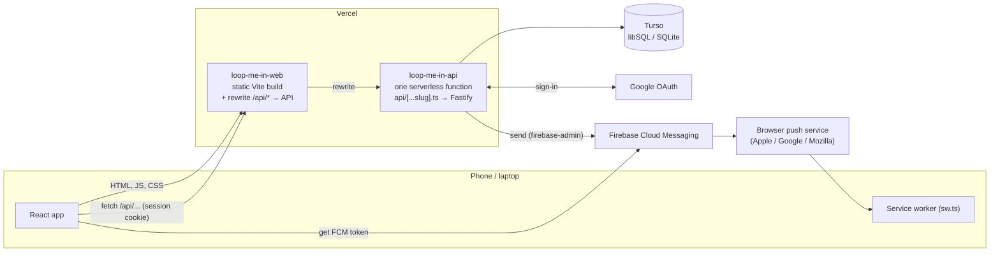
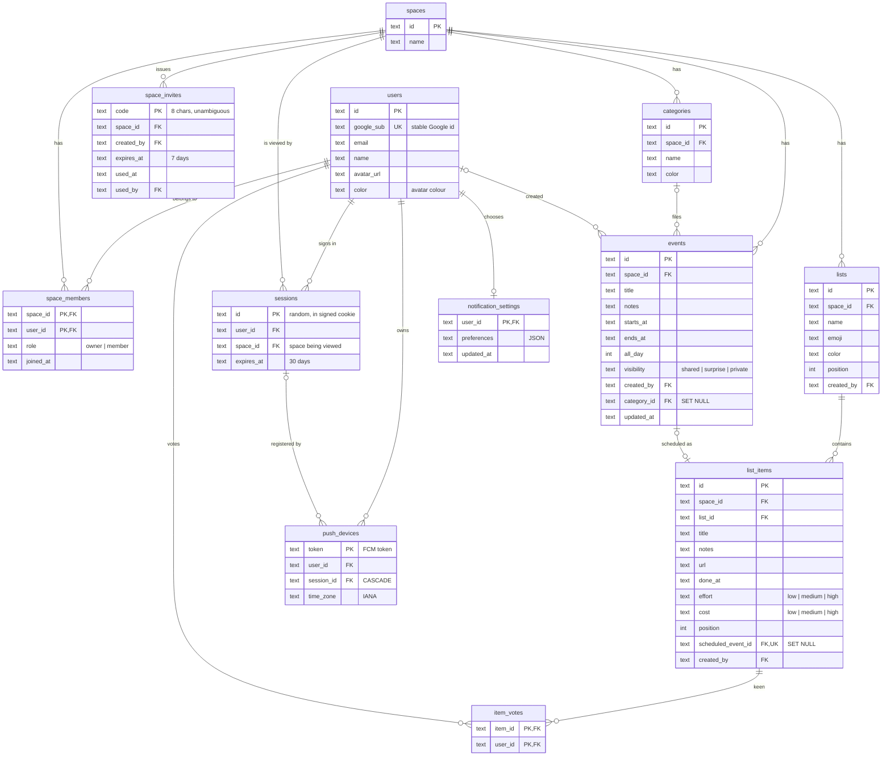
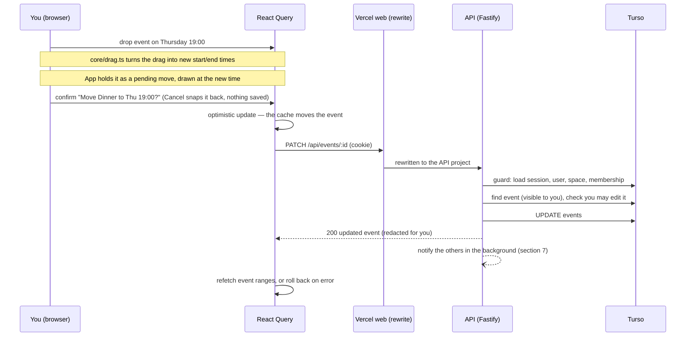
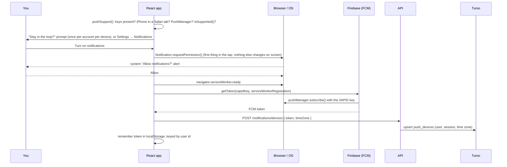
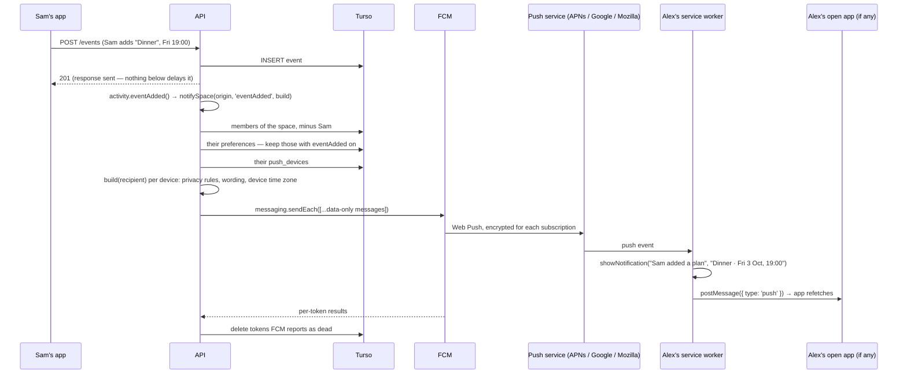
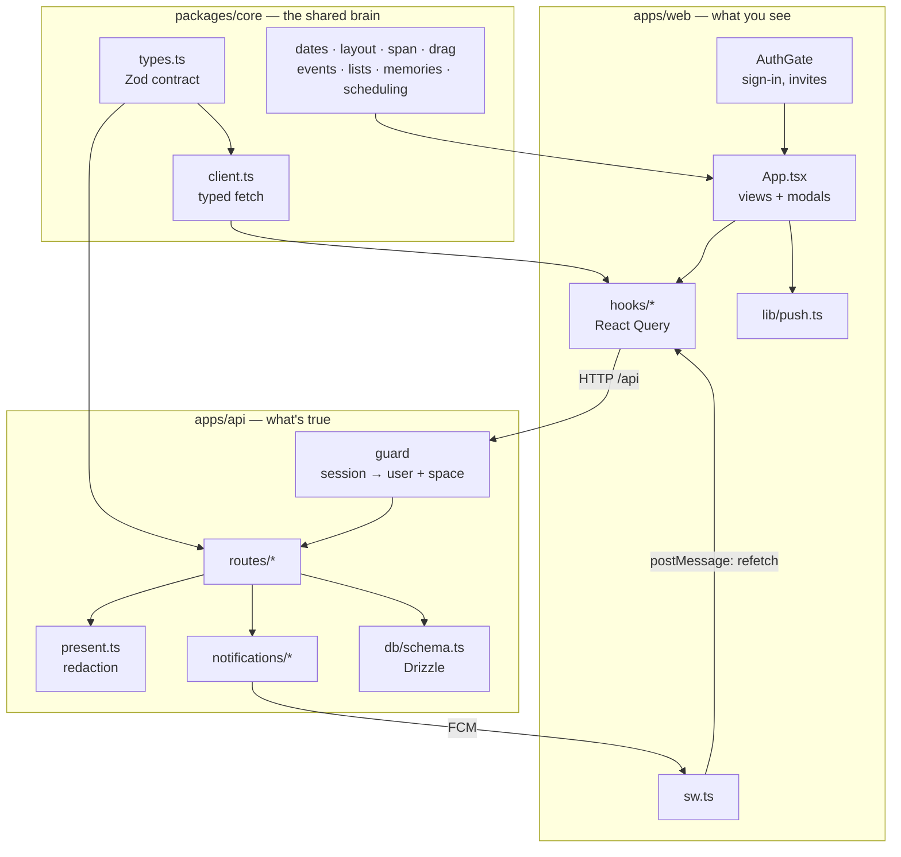

# How Loop Me In works

A shared calendar and lists app for two (or a few) people. This document describes the whole
system: what it's built with, where it runs, how the code is organised, what the database holds,
what the API offers, how push notifications get from one phone to another, and how all of it
fits together.

For setting things up rather than understanding them:
[OAUTH-AND-DEPLOYMENT.md](./OAUTH-AND-DEPLOYMENT.md) (sign-in and hosting) and
[PUSH-NOTIFICATIONS.md](./PUSH-NOTIFICATIONS.md) (Firebase).

---

## 1. The stack

| Layer | Technology | Why |
|---|---|---|
| Web app | React 19, TypeScript, Vite 6, Tailwind CSS 4 | Fast dev server, small build, no CSS files to maintain per component. |
| Server state in the browser | TanStack React Query 5 | Caching, background refetch, optimistic updates and rollback. |
| Installable app | `vite-plugin-pwa` with a hand-written service worker (`sw.ts`, Workbox) | Home Screen icon, offline app shell, and the only way to receive web push. |
| Icons | Font Awesome (solid) | Through one `Icon` wrapper. |
| API | Fastify 5 on Node.js | Plugins for cookies, CORS, OAuth and OpenAPI docs. |
| Validation | Zod 3 (shared) | One set of schemas used by the server to validate and the client to type and parse. |
| Database | SQLite via libSQL: a local file in dev, **Turso** in production | Same driver, same SQL, both places. |
| ORM / migrations | Drizzle ORM + `drizzle-kit push` | Typed queries; the schema file is the source of truth. |
| Sign-in | Google OAuth 2 (`@fastify/oauth2`), server-side sessions | Revocable sessions, no passwords. |
| Push notifications | Firebase Cloud Messaging: `firebase` in the browser, `firebase-admin` on the API | Reaches Chrome, Edge, Firefox and Safari (including iPhone Home Screen apps). |
| Hosting | **Vercel**: two projects (web, API) from one GitHub repo | Static site plus serverless functions. |
| Tests | Vitest, over the UI-free `core` package | Calendar logic tested without a browser. |
| Language / repo | TypeScript everywhere; npm workspaces monorepo | One `npm install`, one `tsc --build`. |

---

## 2. Where it runs



**Two Vercel projects, one origin.** The web project serves the static build. Its
`apps/web/vercel.json` rewrites every `/api/*` request to the API project, so the browser only
ever talks to one domain. That keeps the session cookie first-party: `SameSite=Lax`, no CORS
involved. Locally, Vite's dev proxy does the same job (`/api` → `localhost:3031`).

**The API is one serverless function.** `apps/api/api/[...slug].ts` catches every `/api/*`
path and hands the raw request to the same Fastify app that `npm run dev` runs as a normal
server. The built app is cached on the module, so a warm function instance doesn't rebuild it.

**Deploys.** Both projects are connected to the GitHub repo. A push to `main` builds and
deploys both: the web project from `apps/web`, the API from `apps/api`.

**Configuration** comes from environment variables: `apps/api/.env` and `apps/web/.env.local`
locally, and each Vercel project's settings in production. The full list is at the end of
[OAUTH-AND-DEPLOYMENT.md](./OAUTH-AND-DEPLOYMENT.md#environment-variable-reference).

---

## 3. Code structure

```
loop-me-in/
├── packages/core/            Shared, UI-free logic and the API contract
│   └── src/
│       ├── types.ts            Zod schemas + types: users, spaces, events, lists, notifications
│       ├── client.ts           Typed fetch client for every API endpoint
│       ├── dates.ts            Which days a view shows; period navigation; labels
│       ├── layout.ts           Where timed events sit on an hour column, and overlap columns
│       ├── span.ts             Which day columns a multi-day event spans, and stacking lanes
│       ├── drag.ts             What a drag does to an event's times (snapping, moving, resizing)
│       ├── events.ts           Filtering, grouping, colours, surprise/edit rules
│       ├── lists.ts            Sorting and grouping list items; "keen", "ready to schedule"
│       ├── memories.ts         The timeline of things you've done
│       ├── scheduling.ts       Finding free slots for both people
│       └── __tests__/          Vitest suites for all of the above
│
├── apps/api/                 Fastify API
│   ├── api/[...slug].ts        Vercel entry point → buildApp()
│   ├── drizzle.config.ts       drizzle-kit: local file or Turso, from env
│   └── src/
│       ├── server.ts           Local / long-running entry point → buildApp().listen()
│       ├── app.ts              Builds Fastify: error shape, CORS, cookies, docs, routes, guard
│       ├── config.ts           Every environment variable, in one place
│       ├── core.ts             Re-exports packages/core by relative path (see the file for why)
│       ├── openapi.ts          OpenAPI components generated from the Zod schemas
│       ├── db/
│       │   ├── schema.ts         Drizzle table definitions — the database schema
│       │   ├── index.ts          libSQL client + Drizzle instance
│       │   └── seed.ts           Demo data for local dev (Alice and Bob)
│       ├── auth/
│       │   ├── google.ts         /api/auth/google and its callback
│       │   ├── session.ts        Sessions, cookies, users, spaces, membership
│       │   ├── guard.ts          The onRequest hook every /api route sits behind
│       │   └── invites.ts        Single-use invite codes
│       ├── routes/
│       │   ├── auth.ts           /auth/* and /spaces/*
│       │   ├── categories.ts     /categories
│       │   ├── events.ts         /events
│       │   ├── lists.ts          /lists, /items, votes, scheduling, suggested slots
│       │   ├── notifications.ts  /notifications/settings and /notifications/devices
│       │   ├── present.ts        DB rows → API shapes (including surprise redaction)
│       │   └── helpers.ts        HTTP errors, body parsing
│       └── notifications/
│           ├── firebase.ts       Lazily loads firebase-admin from FIREBASE_SERVICE_ACCOUNT
│           ├── notify.ts         Who to tell, preferences, sending, dead-token cleanup
│           └── activity.ts       The wording of each notification, per recipient
│
└── apps/web/                 React PWA
    ├── index.html              Launch splash (inline CSS so it paints before the bundle)
    ├── vite.config.ts          React, Tailwind, PWA manifest + service worker, /api proxy
    ├── vercel.json             Production /api rewrite to the API project
    └── src/
        ├── main.tsx            React root, QueryClient, AuthGate
        ├── App.tsx             The shell: view state, data hooks, every modal
        ├── sw.ts               Service worker: precache, offline shell, push, notification click
        ├── lib/
        │   ├── api.ts            The one API client instance
        │   ├── push.ts           Push support detection, permission, FCM token, register/unregister
        │   ├── datetime.ts       ISO instants ↔ <input> values
        │   ├── decorations.ts    Per-event marks: whose, private, which list
        │   ├── splash.ts         Takes the launch splash down at the right moment
        │   └── viewport.ts       Keeps --app-height honest on iOS
        ├── hooks/
        │   ├── queryKeys.ts      Every React Query key
        │   ├── useAuth.ts        Session, spaces, invites
        │   ├── useCalendarData.ts Events and categories (optimistic moves)
        │   ├── useLists.ts       Lists, items, votes, scheduling
        │   ├── useNotifications.ts Preferences + this device's on/off state
        │   └── use*Drag.ts, useViewSwipe.ts, useIsMobile.ts   Gestures and layout
        └── components/
            ├── auth/             AuthGate (sign-in screen, invite redemption), SpaceModal
            ├── calendar/         Month, time grid (week / 3-day / day), agenda, event dialogs, filters
            ├── layout/           Phone header, tab bar, calendar bar, FAB; space switcher
            ├── lists/            Lists screen and its dialogs
            ├── memories/         Memories timeline
            ├── spaces/           Spaces page
            ├── settings/         Settings sheet, Notifications page, first-run prompt
            └── ui/               Modal (bottom sheet on phones), Icon, Avatar, Switch
```

**The one hard rule:** nothing in `packages/core` may import React or touch the DOM. Every
decision about *where an event sits*, *what a drag means* or *which days a view covers* lives
there as a pure function. The web app measures pixels and pointer events, then asks `core`.
That's what makes the 157 tests possible without a browser.

**The contract is shared, not duplicated.** `core/types.ts` defines each request and response
once, as a Zod schema. The API validates incoming bodies with it, the OpenAPI docs are generated
from it, and the client parses responses with it. If the shapes drift, `tsc` fails.

---

## 4. Database schema

SQLite (libSQL). All timestamps are ISO 8601 UTC strings, which sort correctly as text, so range
queries are plain `>=` / `<=`. Ids are UUIDs, except invite codes. The schema lives in
`apps/api/src/db/schema.ts` and is applied with `npm run db:push`.



### The rules that matter

- **Everything belongs to a space.** Every calendar and list row has a `space_id`, and every query
  filters by the session's current space. The client never chooses the space: it comes from the
  session row on the server.
- **Deleting never takes your plans with it.** `events.category_id` and
  `list_items.scheduled_event_id` are `ON DELETE SET NULL`. Delete a category and its events turn
  grey. Delete an event and its list item becomes unscheduled again, not deleted. Delete an
  account and its events stay, with `created_by` null.
- **Deleting a container does cascade.** Deleting a list removes its items. Deleting a space
  removes everything in it. `deleteSpace` in `auth/session.ts` deletes the children explicitly,
  in one transaction, rather than relying on the cascade. It moves every session viewing the
  space to another space first, because otherwise the sessions would cascade away too, signing
  people out and switching off their push notifications.
- **Roles matter in one place: ending a membership.** `space_members.role` is `owner` for
  whoever created the space, `member` for everyone else. The owner can delete the space but can't
  leave it or be removed. Members can leave, or be removed by anyone in the space. Together these
  rules mean a space always has an owner, so it can always be deleted. Renaming and inviting are
  open to everyone.
- **Visibility is per event.** `private` events are only returned to their creator. `surprise`
  events are returned to everyone, but with the title, notes and category stripped for anyone but
  the creator (`routes/present.ts → toEvent`). The same rules hide a surprise's date on the list
  item it was scheduled from, and decide what a notification may say.
- **A list item and its event are one-to-one.** `scheduled_event_id` has a unique index.
- **Push devices die with their session.** Signing out deletes the session row, and the cascade
  deletes that device's FCM token, so it stops receiving notifications.
- **Preferences are JSON, merged over defaults.** Adding a notification kind later needs no
  migration, and nobody's existing choices change.

Foreign keys are enforced: `PRAGMA foreign_keys = ON` locally, and always on in Turso.

---

## 5. The API

Base path `/api`. JSON in and out. Errors are always `{ error, details? }`. Everything except
sign-in and health needs the session cookie: the guard in `auth/guard.ts` runs before every
route and puts `request.auth = { user, space, sessionId }` on the request.

Interactive docs (Swagger UI) at <http://localhost:3031/docs> in development. Raw OpenAPI 3.1 at
`/docs/json`.

### Auth and spaces

| Method | Path | What it does |
|---|---|---|
| GET | `/auth/google` | Starts Google sign-in. `?join=CODE` remembers an invite for the way back. |
| GET | `/auth/google/callback` | Finishes sign-in: upserts the user, redeems any invite, creates the session, sets the cookie. |
| GET | `/auth/me` | Who you are, the space you're viewing, its members, and all your spaces. **A 401 here means "show sign-in".** |
| POST | `/auth/logout` | Deletes the session (and with it this device's push token) and clears the cookie. |
| PUT | `/auth/space` | Switch which space this session is viewing. |
| POST | `/spaces` | Create a space and switch to it. |
| PATCH | `/spaces/:id` | Rename a space. |
| DELETE | `/spaces/:id` | **Owner only.** Delete a space and everything in it, for everyone. Anyone viewing it is moved to another of their spaces (or a fresh one), so nobody is signed out. |
| POST | `/spaces/invites` | Create a single-use invite link (7 days). |
| POST | `/spaces/join` | Redeem an invite code. |
| POST | `/spaces/:id/leave` | **Members only** (not the owner). Leave a space. Like being removed, but your sessions move to another space instead of signing out. |
| DELETE | `/spaces/members/:id` | Remove someone, except the owner. Their private and surprise events go with them; everything shared stays. |

### Calendar

| Method | Path | What it does |
|---|---|---|
| GET | `/events?from&to` | Events overlapping a window, filtered and redacted for you. |
| POST | `/events` | Create an event. |
| PATCH | `/events/:id` | Change any fields. Making someone else's event secret takes ownership of it. A surprise can only be changed by its creator. |
| DELETE | `/events/:id` | Delete an event. A linked list item becomes unscheduled. |
| GET | `/categories` | All categories. |
| GET | `/categories/counts` | Events per category, for the delete warning. |
| POST / PATCH / DELETE | `/categories[/:id]` | Manage categories. Deleting one keeps its events. |

### Lists

| Method | Path | What it does |
|---|---|---|
| GET | `/lists` | All lists. |
| POST / PATCH / DELETE | `/lists[/:id]` | Manage lists. Deleting a list deletes its items. |
| GET | `/items` | Every item in the space, with votes and scheduled dates. |
| POST | `/lists/:id/items` | Add an item. |
| PATCH / DELETE | `/items/:id` | Edit, tick off, reorder, move between lists, delete. |
| PUT / DELETE | `/items/:id/vote` | Add or remove your "I'm keen". |
| POST | `/items/:id/schedule` | Give an item a date: creates (or moves) its linked event, in one transaction. |
| DELETE | `/items/:id/schedule` | Take it off the calendar: deletes the event, keeps the item. |
| GET | `/items/:id/suggested-slots` | Free times when neither of you is busy. |

### Notifications

| Method | Path | What it does |
|---|---|---|
| GET | `/notifications/settings` | Your preferences, plus whether the server can send at all (`pushConfigured`). |
| PATCH | `/notifications/settings` | Turn kinds on or off. |
| POST | `/notifications/devices` | Register this browser's FCM token and time zone. Idempotent. |
| DELETE | `/notifications/devices/:token` | Unregister a browser. |

### System

| Method | Path | What it does |
|---|---|---|
| GET | `/health` | `{ ok: true }`. |

---

## 6. A request, end to end

Moving an event on the week view, as an example:



The pattern is the same everywhere:
1. The guard resolves who you are and which space you're in.
2. The body is parsed with the shared Zod schema.
3. The query is scoped to your space and visibility.
4. The row is written.
5. The response goes through a presenter in `present.ts`, which strips anything you mustn't see.
6. Notifications go out after the response, never holding it up.

On the client, mutations update the React Query cache optimistically and roll back on failure.
Dragging is the one place that asks first: a drop only proposes a time (`MoveConfirmBar`), because
every saved move notifies the other person, and nudging an event into place over a few drags
would otherwise send one notification per drag.
Events are cached per visible date range, and invalidation refreshes every range at once.

---

## 7. Push notifications, end to end

### The parts

| Piece | Where | Role |
|---|---|---|
| Firebase project | Firebase console | Issues tokens and relays messages. Holds the web app config and the VAPID key. |
| `firebase/messaging` | `apps/web/src/lib/push.ts` | In the browser: checks support, gets this browser's **FCM token**. Loaded lazily. |
| Service worker | `apps/web/src/sw.ts` | Receives the push even when the app is closed, shows the notification, handles taps. |
| Device registry | `push_devices` table | Which tokens belong to which user and session, and each one's time zone. |
| Preferences | `notification_settings` table | Which kinds each account wants. |
| `firebase-admin` | `apps/api/src/notifications/firebase.ts` | On the API: authenticated with the service-account key, sends messages. |
| Fan-out and wording | `notify.ts`, `activity.ts` | Who should hear, what it says to each of them, and cleanup of dead tokens. |

### Turning it on (once per device)



On every launch, `refreshPush` re-registers a device that's turned on. Tokens rotate, sessions
change and people travel across time zones, and re-sending is cheaper than detecting any of
those. If permission was revoked in the browser's settings, it stops claiming to be on.

### Sending one



### The details worth knowing

- **Who's notified:** everyone else in the space where the change happened, never the person
  who made it. The one exception is `NOTIFY_SELF=true` in development, because there everyone is
  `AUTH_DEV_USER`.
- **What triggers one:**

  | Kind | Triggered by |
  |---|---|
  | `eventAdded` | creating an event, or taking one out of *Just me* |
  | `eventChanged` | changing the time or the title, *not* notes or category. A drag only counts once confirmed. |
  | `eventRemoved` | deleting an event |
  | `itemAdded` | adding to a list |
  | `itemKeen` | a new keen vote. The message changes when you're both keen. |
  | `itemScheduled` | giving an item a date, or moving it |
  | `memberJoined` | redeeming an invite, from the Spaces page or during Google sign-in |
  | `memberLeft` | a member leaving a space |
  | `spaceDeleted` | the owner deleting a space. The members are captured before the delete, since the space can't be asked afterwards. |

- **Privacy follows the calendar.** Builders run once per recipient, with the same rules as
  `toEvent`. A *Just me* event produces nothing. A *Surprise* says "Sam planned a surprise —
  something's happening Fri 3 Oct", never the title. An event that becomes *Just me* doesn't
  announce that it vanished.
- **Messages are data-only.** The service worker always draws the notification itself. That
  means the same look on every platform, and on Safari, which revokes push from sites that
  receive a push without showing a notification, a notification is always shown.
- **One notification per thing.** Each message carries a `tag` such as `event-<id>`, so
  dragging an event around four times leaves one notification about where it ended up.
- **It never slows a request down.** Sending runs after the response, wrapped in
  `waitUntil` from `@vercel/functions`, so Vercel keeps the function alive until it finishes.
  Elsewhere `waitUntil` is a no-op and the promise just runs. Failures are logged, never thrown.
- **firebase-admin loads lazily** on the first send, so cold starts that don't send don't pay
  for it. Without `FIREBASE_SERVICE_ACCOUNT`, sending is a silent no-op and the settings page
  says the server isn't set up.
- **Tapping a notification** focuses the open app, or opens it if it isn't running.
- **iPhone:** web push only works in the Home Screen app (iOS 16.4+). `pushSupport()` returns
  `needs-install` in a Safari tab, and the prompt and settings page explain that instead of
  offering a button that can't work there.
- **Per account vs per device.** Preferences belong to the account and apply everywhere.
  Whether a device receives at all is per browser, because permission is granted per browser.
  The saved token is keyed by user id, so a second person signing in on the same browser
  doesn't inherit the first person's yes.

---

## 8. How it all fits together



- **`core` is the shared brain.** It defines what the data looks like (`types.ts`), how to ask
  for it (`client.ts`) and every calendar calculation. The web app and the API both import it,
  so they agree on shapes by construction.
- **The API is the single source of truth and the single enforcer of privacy.** Scope (which
  space), visibility (private, surprise) and permissions (who may edit) are all decided on the
  server. The client is never trusted with data it mustn't show: surprises are redacted before
  they leave the API, not hidden in the UI.
- **The web app** keeps a cache of what the API said, shows it, and shows changes optimistically
  before the server confirms. When a push arrives while the app is open, the service worker tells
  it to refetch, so what the notification says is already on screen.
- **Notifications are a side effect of writes.** A route writes, responds, then hands a
  description of what happened to `activity.ts`. That works out what each other member may know,
  and `notify.ts` gets it to their devices through Firebase.
- **Sessions tie it together.** A session says who you are, which space you're viewing, and
  (through `push_devices.session_id`) which devices should buzz for you. Delete the session and
  all three answers go with it.

---

## 9. Working on it

```bash
npm install
npm run db:push        # apply schema.ts to the local SQLite file
npm run seed           # demo space with alice@ and bob@example.com
npm run dev            # API on :3031, web on :5173 (AUTH_DEV_USER skips Google)
npm test               # core logic tests
npm run typecheck      # tsc --build across core, api, web and the service worker
npm stop               # stop dev servers cleanly
```

**Changing the schema:** edit `apps/api/src/db/schema.ts`, run `npm run db:push` locally, then
run it once against Turso before deploying code that needs it (see PUSH-NOTIFICATIONS.md
step 6 for the command).

**Adding an endpoint:**
1. Add the Zod schema to `core/types.ts` and a method to `core/client.ts`.
2. Add the route under `apps/api/src/routes/`, validating with `parseBody(schema, body)` and
   documenting with a schema from `openapi.ts`.
3. Add a hook under `apps/web/src/hooks/`.

**Adding a notification kind:**
1. Add it to `NOTIFICATION_KINDS` in `core/types.ts`. It defaults to on, with no migration.
2. Write its builder in `api/notifications/activity.ts`.
3. Call the builder from the route after the write.
4. Add a row to `GROUPS` in `web/components/settings/NotificationSettings.tsx`.
